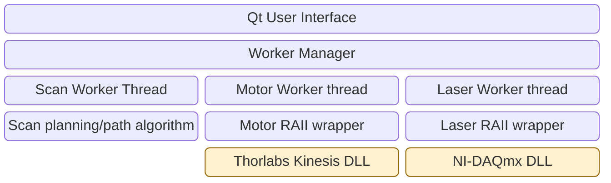
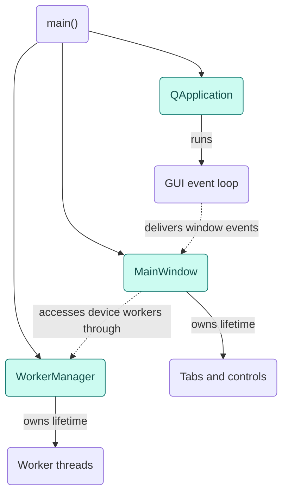
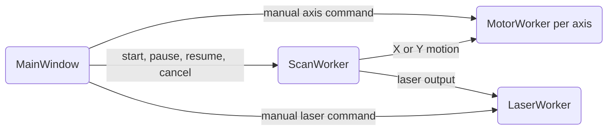

# High-level overview

## Software stack




| Component | Responsibility | Source |
| --- | --- | --- |
| `MainWindow` | Owns the controls, sends operator requests to workers, and displays results. | [main_window.cc](../src/ui/main_window/main_window.cc), [worker_connections.cc](../src/ui/main_window/worker_connections.cc) |
| `WorkerManager` | Owns the five worker threads and manages their startup and shutdown. | [worker_manager.cc](../src/workers/worker_manager/worker_manager.cc) |
| Scan planner | Converts an image into move, laser, and wait instructions on the GUI thread. | [conversion.cc](../src/algo/convert/conversion.cc), [algorithm.cc](../src/algo/algorithm/algorithm.cc), [instructions.h](../src/algo/instructions/instructions.h) |
| Scan preview | Displays the planned scan path in the Scan tab. | [scan_preview.cc](../src/ui/scan_tab/scan_preview/scan_preview.cc) |
| `ScanWorker` | Executes the scan program by coordinating X/Y motion, laser output, and exposure timing. | [scan_worker.cc](../src/workers/scan_worker/scan_worker.cc) |
| `MotorWorker` (one per axis) | Executes motion commands and monitors its axis position and status. | [motor_worker.cc](../src/workers/motor_worker/motor_worker.cc) |
| `LaserWorker` | Switches the laser output on or off and reports the result. | [laser_worker.cc](../src/workers/laser_worker/laser_worker.cc) |
| `NRT100` (motor RAII wrapper) | Acquires and releases one channel on the shared Thorlabs Kinesis controller. | [nrt100.cc](../src/devices/nrt100/nrt100.cc) |
| `Pcie6323Laser` (laser RAII wrapper) | Creates and clears the NI-DAQmx task that drives the laser’s digital output line. | [pcie6323_laser.cc](../src/devices/pcie6323_laser/pcie6323_laser.cc) |

## On startup

1. `main()` creates the Qt application (`QApplication`) on the main thread.
2. `main()` creates `WorkerManager`. Its constructor registers the cross-thread message types with Qt, then starts the worker threads.
3. `main()` creates `MainWindow`, connects it to the workers with `ConnectWorkers()`, registers the shutdown handler, and shows the window.
4. `main()` calls `app.exec()` to start the GUI event loop on the main thread.

### Ownership/Relationship Diagram



### Command coordination



See [Design decisions](design_decisions.md) for the rationale behind C++23, Qt, and worker thread ownership.

See [Hardware and deployment](hardware.md) for hardware assumptions, the system diagram, and the deployment inventory.

## Directory structure

The application starts in [src/main.cc](../src/main.cc), which creates the Qt application, worker manager, and main window.

### `algo/`

The planner converts an image into a binary pattern, then generates the moves, laser commands, and waits needed to write it.

```text
algo/
├── algorithm/       # Scan path and instruction generation
├── convert/         # Image-to-pattern conversion
└── instructions/    # Instruction and program types
```

### `devices/`

The device wrappers manage motor channels and the laser output task using the vendor APIs.

```text
devices/
├── kinesis_simulation/   # Kinesis simulator session
├── nrt100/               # NRT stage channels on the shared controller
└── pcie6323_laser/       # NI-DAQmx digital output for the laser
```

### `error/`

Device wrappers and workers use a shared error type to report failures and carry vendor error details back to the UI.

```text
error/
├── error.h
└── error.cc
```

### `ui/`

The main window assembles the tabs and connects their controls to the workers. Each tab groups the widgets for one operator task.

```text
ui/
├── laser_tab/              # Laser controls
│   └── laser_control/      # Connection and digital output
├── main_window/            # Window layout and worker connections
├── motor_tab/              # Manual axis operation
│   ├── motor_control/      # Connection and motion commands
│   └── motor_information/  # Axis readings and settings
├── options_tab/            # Configuration widgets
│   └── options/            # Axis settings controls
├── scan_tab/               # Scan preparation and execution
│   ├── image/              # Image import and start-pixel selection
│   ├── scan_control/       # Scan execution controls
│   └── scan_preview/       # Planned scan path display
└── shared/                 # Display helpers used across tabs
    └── status/             # Status and error messages
```

### `workers/`

Device workers execute requests on their own threads. The scan worker coordinates them, and the worker manager handles thread startup and shutdown.

```text
workers/
├── laser_worker/     # Laser commands and output state
├── motor_worker/     # Motion commands and polling for one axis
├── scan_worker/      # Scan sequence and exposure timing
└── worker_manager/   # Worker thread lifetimes
```
