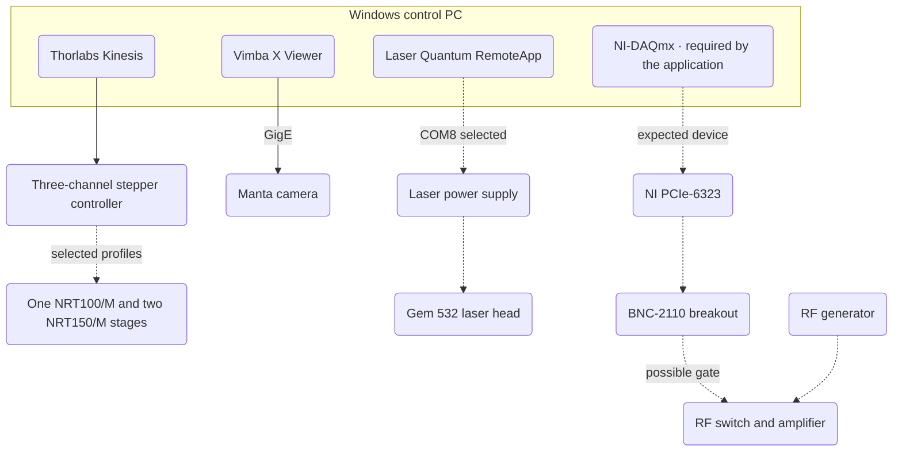
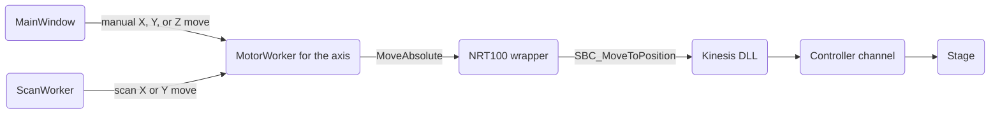
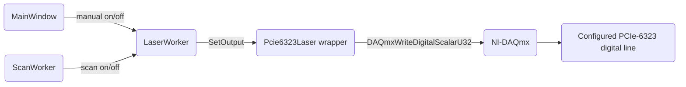

# Hardware and deployment

## Deployment structure

Solid lines show associations visible in the 6 November 2026 photos and screenshots. Dotted lines show expected or unverified connections. The photos identify the breakout panel, while the DAQ model, axis mapping, and signal path from the panel to the optics still need physical verification.

## Motor command route

The caller queues the request on the axis worker. The wrapper converts millimetres to device units, and the worker monitors motion and reports completion. The application defaults to 150 mm travel on X/Z and 100 mm on Y. Each axis needs a distinct channel on the shared controller.

## Laser command route

The wrapper checks the DAQ model and configured serial (default `0185BDED`). Digital mode requires confirmed high-on, low-off wiring and the actual output line. The worker reports whether the DAQ write succeeded. Optical output is unmeasured.

## Component inventory

Versions below come from the deployment evidence. Application requirements are marked explicitly.

| Component | Version or model | Purpose |
| --- | --- | --- |
| Control PC | Windows 10 Home 22H2, build 19045.6466 | Hosts the control software. |
| Qt desktop application | Requires Qt 6.5+ | Issues motion and exposure commands. |
| Thorlabs Kinesis | 1.14.41, build 21985 (64-bit) | Configures and controls motion devices. |
| Stepper controller | ID 70871422, firmware 3.00.11, model unconfirmed | Drives three stage channels. |
| Translation stages | NRT100/M and NRT150/M profiles in Kinesis | Position the axes. |
| K-Cube DC controllers | Four listed, unloaded | Lab role unconfirmed. |
| NI-DAQmx and DAQ | Driver version unconfirmed. Application expects PCIe-6323. | Switch the digital output line. |
| NI breakout panel | BNC-2110 | Exposes DAQ signals on connectors. |
| Laser Quantum RemoteApp | 1.2.0.0 | Configures the laser supply. Shown disconnected. |
| Laser head and supply | Gem 532 head. Supply model unverified. | Generate 532 nm light. |
| RF generator | Model unconfirmed | Supplies an RF signal. |
| RF switch and amplifier | Mini-Circuits ZASWA-2-50DR+ and ZHL-1-2W-S+ | Switch and amplify RF. Optical modulation path unverified. |
| Allied Vision Vimba X Viewer | 1.4.4.425f85f | Displays camera images. |
| Allied Vision camera | Manta G-1236C, firmware 00.01.54.20343 | Captures images over GigE. |
